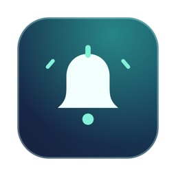
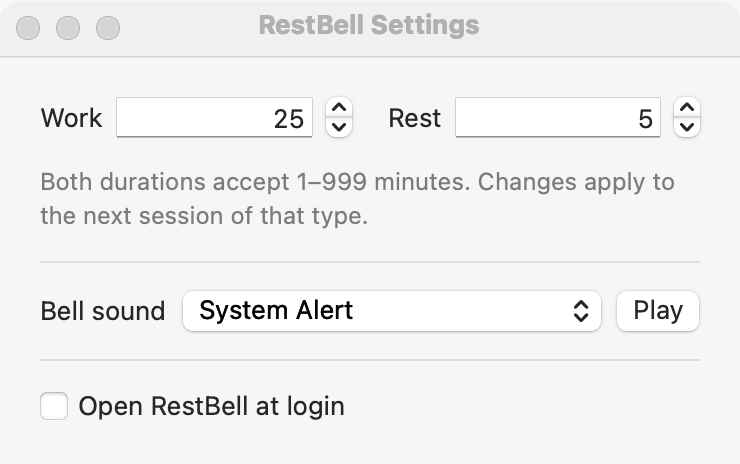

# RestBell

RestBell is a small macOS menu bar timer for alternating work and eye breaks. It uses Swift, AppKit, and SwiftUI with no external dependencies.

## Screenshots


<picture>
  <source media="(prefers-color-scheme: dark)" srcset="docs/screenshots/settings-dark.png">
  
</picture>

## Download

Get `RestBell.dmg` from [GitHub Releases](https://github.com/ConnectWithMehrshad/RestBell/releases/latest). Open the disk image and drag RestBell to Applications. The disk image supports Apple silicon and Intel Macs running macOS 14 or later.

The release uses ad hoc signing and has no Apple notarization. macOS may block the downloaded app.

## Build and open

Use macOS 14 or later and the Apple command line tools with Swift 6. From the repository, run:

```sh
app="$(./scripts/build-app)" && open "$app"
```

For a permanent copy you can open at login, copy the built bundle into your Applications folder.

```sh
app="$(./scripts/build-app)" &&
  mkdir -p "$HOME/Applications" &&
  ditto "$app" "$HOME/Applications/RestBell.app" &&
  open "$HOME/Applications/RestBell.app"
```

## Use

- Click **RestBell** in the menu bar to see your work/rest minutes above **Start**. Choose **Start** to begin a work session.
- The menu bar shows **W** for work and **R** for rest, followed by the time remaining. Before each switch, it counts down from 3 and plays the selected bell sound once per second.
- **Reset** stops the cycle. The next **Start** begins a full work session.
- In **Settings…**, enter 1–999 whole minutes for work and rest or use the arrows to adjust either by one minute. Valid entries save when you press Return or leave the field. The defaults are 25 and 5 minutes. Changes apply the next time that session starts.
- Choose a **Bell sound** and click **Play** to hear it. RestBell enables **Open RestBell at login** by default when installed in Applications. You can turn it off in Settings.
- The countdown freezes while the Mac sleeps.

## Development

Run `swift test --disable-xctest` to check the work/rest cycle and reset behavior. GitHub Actions runs these tests and verifies the app bundle on macOS.

With Python 3.10 or later, run `./scripts/build-dmg` to build the universal disk image at `.build/RestBell.dmg`. The first build downloads the packaging tools into `.build`. Pushing a version tag that matches the app version triggers the GitHub release workflow.
